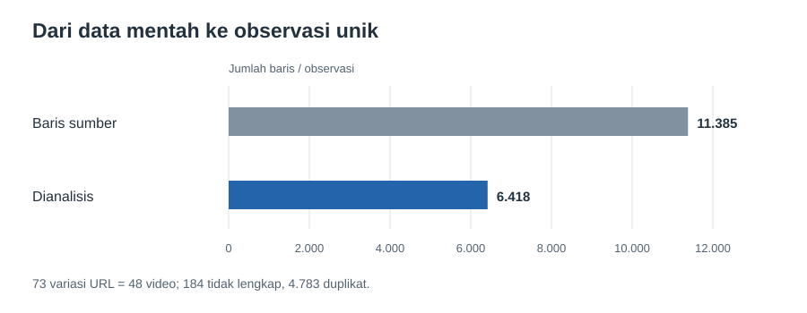

# Apa yang bisa dibaca dari komentar YouTube tentang Sheila Dara dan *Sore*?

**Portofolio analisis data dan teks berbahasa Indonesia.** Proyek ini mengubah ekspor komentar YouTube menjadi temuan yang dapat ditelusuri: mulai dari membetulkan hitungan video, membandingkan kelompok komentar, sampai menentukan analisis mana yang masih perlu diperiksa manusia.

**Peran saya:** pembersihan data, analisis eksploratif, visualisasi, pipeline Python, dan dokumentasi.

**Alat:** Python, Pandas, scikit-learn, notebook, SVG.
**Mulai dari:** [notebook analisis dengan hasil yang sudah tampil](Sheila_Dara_Sore_YT_Sentiment.ipynb).

## Cerita di balik data

Ekspor awal berisi **11.385 baris** dan **73 variasi URL**. Setelah URL diidentifikasi berdasarkan ID video, ternyata hanya ada **48 video**. Sebagian baris juga tidak lengkap atau mengulang komentar dengan akun dan teks yang sama pada video yang sama. Jika data mentah langsung dihitung, jumlah observasi akan menyesatkan.

Saya membuat satu unit analisis berupa **ID video + akun + teks komentar**. Setelah 184 baris tidak lengkap dan 4.783 pengulangan dikeluarkan, tersedia **6.418 observasi** untuk dianalisis. Komentar identik pada video yang berbeda tetap dihitung sebagai observasi berbeda.

## Temuan utama

**1. Sekitar satu dari enam komentar menyebut Sheila.** Ada **1.046 dari 6.418 observasi (16,30%)** yang memuat kata “Sheila”. Angka ini menyatakan frekuensi penyebutan dalam ekspor, bukan proporsi seluruh penonton atau penggemar. [Lihat grafik jumlah komentar](assets/mention.svg).

**2. Komentar yang menyebut Sheila cenderung lebih panjang.** Rata-ratanya **21,01 token**, dibanding **14,12 token** pada komentar lain. Median masing-masing **13** dan **8** token. Pada 11 video yang memiliki sedikitnya 10 komentar di setiap kelompok, arah perbedaannya sama.

**3. Sebagian besar observasi terkumpul di sedikit video.** Lima video dengan komentar terbanyak menyumbang **71,72%** observasi. Karena itu, angka gabungan saja kurang cukup untuk menggambarkan seluruh 48 video. [Laporan per video tersedia sebagai CSV](reports/video_summary.csv).

**4. Aturan sentimen memberi sinyal awal, belum kesimpulan opini publik.** Aturan kata menandai **26,96%** komentar yang menyebut Sheila sebagai positif, dibanding **14,50%** komentar lain. Perbedaan ini konsisten arahnya pada 11 video yang memenuhi batas sampel di atas. Namun, aturan belum dinilai terhadap label manusia, sehingga angka ini **tidak boleh dibaca sebagai akurasi model atau bukti sebab akibat**.

## Apa yang sebaiknya dilakukan dari temuan ini?

| Temuan | Langkah yang dapat diuji |
| --- | --- |
| Banyak URL dan baris berulang | Gunakan ID video sebagai kunci saat impor dan audit duplikat sebelum membuat dashboard. |
| Lima video mendominasi data | Tampilkan hasil per video; kumpulkan sampel yang lebih seimbang sebelum menyimpulkan pola audiens. |
| Komentar Sheila lebih panjang | Baca dan kodekan sampel komentar untuk melihat topik berulang. Panjang teks saja belum menjelaskan alasannya. |
| Label positif aturan berbeda antarkelompok | Minta penilai manusia independen memberi label, lalu ukur kesalahan aturan sebelum memakai klaim sentimen. |
| **417 komentar** memiliki tanda tanya | Tinjau pertanyaan faktual secara manual sebelum menyusun FAQ. Tanda tanya saja belum tentu pertanyaan yang perlu dijawab. |

Langkah analisis per video, perbandingan dalam video, telaah sampel, dan antrean anotasi tersedia langsung di [notebook utama](Sheila_Dara_Sore_YT_Sentiment.ipynb). [Telaah awal](reviews/README.md) dilakukan dengan bantuan asisten untuk menemukan calon masalah; hasilnya **bukan validasi manusia independen**. Sampel anotasi mentah disimpan lokal dan tidak masuk repositori.
