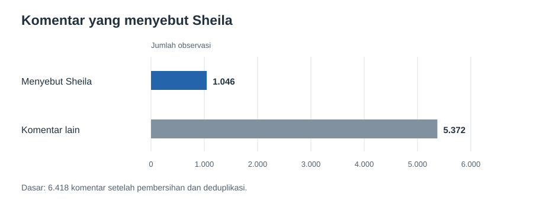
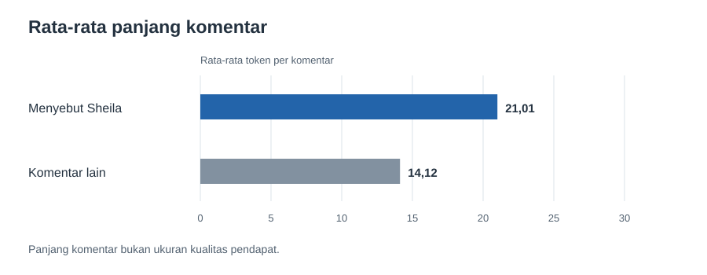
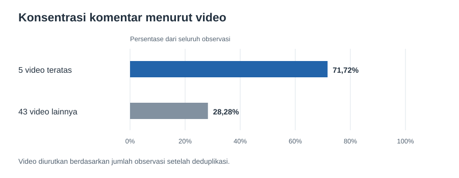
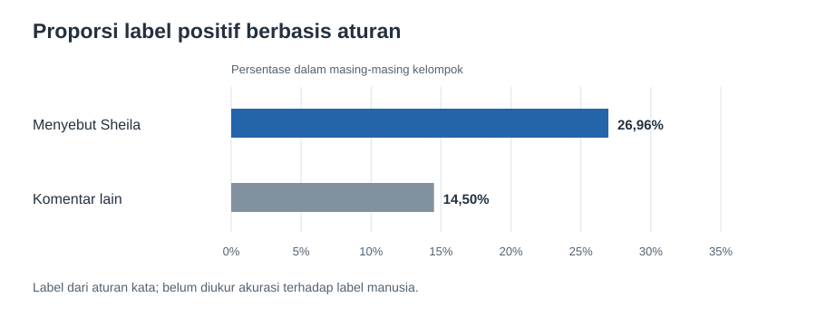

# Apa yang bisa dibaca dari komentar YouTube tentang Sheila Dara dan *Sore*?

**Portofolio analisis data dan teks berbahasa Indonesia.** Saya menganalisis **6.418 observasi komentar dari 48 video YouTube** untuk melihat seberapa sering Sheila Dara disebut, bagaimana panjang komentarnya, dan apa yang dapat disimpulkan secara hati-hati dari pola tersebut.

**Peran saya:** pembersihan data, analisis eksploratif, visualisasi, pipeline Python, dan dokumentasi.

**Alat:** Python, Pandas, scikit-learn, notebook, SVG.
**Mulai dari:** [notebook analisis dengan hasil yang sudah tampil](Sheila_Dara_Sore_YT_Sentiment.ipynb).

## Temuan utama

**1. Sekitar satu dari enam komentar menyebut Sheila.** Ada **1.046 dari 6.418 observasi (16,30%)** yang memuat kata “Sheila”. Angka ini menyatakan frekuensi penyebutan dalam ekspor, bukan proporsi seluruh penonton atau penggemar.

**2. Komentar yang menyebut Sheila cenderung lebih panjang.** Rata-ratanya **21,01 token**, dibanding **14,12 token** pada komentar lain. Median masing-masing **13** dan **8** token. Pada 11 video yang memiliki sedikitnya 10 komentar di setiap kelompok, arah perbedaannya sama.

**3. Sebagian besar observasi terkumpul di sedikit video.** Lima video dengan komentar terbanyak menyumbang **71,72%** observasi. Karena itu, angka gabungan saja kurang cukup untuk menggambarkan seluruh 48 video. [Laporan per video tersedia sebagai CSV](reports/video_summary.csv).

**4. Aturan sentimen memberi sinyal awal, belum kesimpulan opini publik.** Aturan kata menandai **26,96%** komentar yang menyebut Sheila sebagai positif, dibanding **14,50%** komentar lain. Perbedaan ini konsisten arahnya pada 11 video yang memenuhi batas sampel di atas. Namun, aturan belum dinilai terhadap label manusia, sehingga angka ini **tidak boleh dibaca sebagai akurasi model atau bukti sebab akibat**.

## Kesimpulan

Komentar yang menyebut Sheila memang lebih sedikit, tetapi cenderung lebih panjang. Arah perbedaan ini juga terlihat pada **11 video** dengan cukup komentar di kedua kelompok. Isi komentar tersebut layak dibaca lebih jauh untuk mengetahui topik yang sering dibahas.

Aturan kata lebih sering memberi label positif pada komentar yang menyebut Sheila, tetapi **belum cukup untuk menyimpulkan pendapat penonton**. Selain itu, **71,72%** observasi berasal dari lima video. Jadi, hasil ini menunjukkan pola dalam ekspor yang tersedia; tema dan nada komentarnya perlu diperiksa per video serta dinilai manusia sebelum menjadi kesimpulan yang lebih luas.
